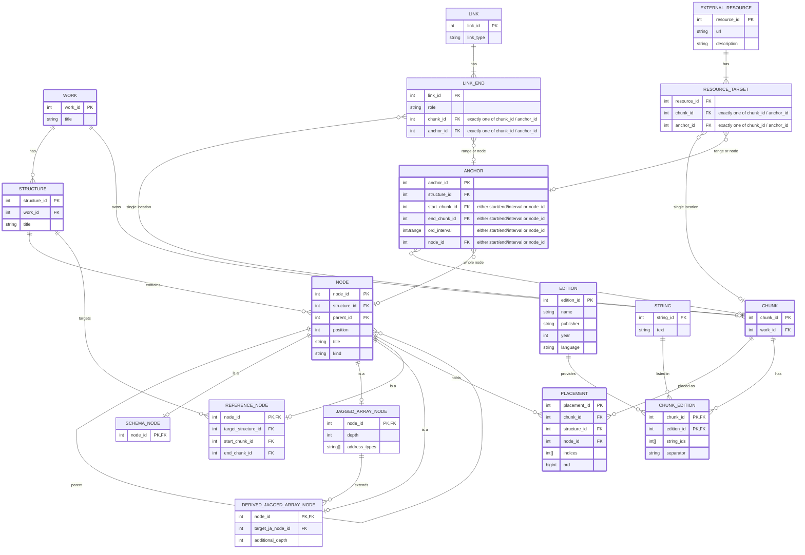

# Rethinking Sefaria's Text Data Model

This paper proposes a clearer conceptual model for Sefaria's textual library and argues that a relational database is a natural way to store it. The model rests on a few distinctions:

* **Work is not structure.** One work can have several complete ways of organizing and addressing its text.
* **Structure is not edition.** A structure defines locations; an edition supplies textual content and publication metadata.
* **Location is not string.** A textual location has an identity independent of the string stored for a particular edition.
* **A chunk is not a canonical label.** Its address comes from the structure, while human-readable refs are generated from structural information and any necessary numbering rules.
* **Addresses can be corrected; identities persist.** If the numbering is fixed, a ref like `Genesis 5:6` follows the new numbering, while links keep pointing to the same text.
* **Organization is not address space.** A reference node can group existing locations without creating new textual coordinates.
* **A derived node extends an address space.** It reuses a target node's dimensions and adds further address dimensions.
* **A location can appear in several structures of its work, but only once in each.** Within one structure, multiple occurrences have distinct locations while sharing underlying strings.
* **Only refs in use are entities.** Persistent entities represent structural nodes, chunks, and the ranges that something actually points to. Every other possible range is computed, not stored.

The sections below explain these distinctions and how the model arrived at them, including some alternatives I considered and set aside.

## Introduction

Sefaria's textual library presents two related modeling challenges.

First, textual structures are more complicated than a simple linear book divided into pages. Works have different hierarchies, address systems, and organizational schemes. Second, Sefaria is not just a collection of linear texts intended to be read from beginning to end. Textual units have independent identities and relationships to other texts, manuscripts, images, audio, URLs, and other resources.

Sefaria's current data model handles these complexities, but its MongoDB representation does not always make the underlying conceptual entities and relationships explicit.

This paper makes two claims, and it is worth keeping them apart. The first is conceptual: the library is better described by a small set of explicit entities — works, structures, locations, editions, and strings — than by the current combination of indexes and versions. The second is about storage: most of this model is entities and relationships between them, which is what relational databases are built for. A relational database can enforce relationships with constraints, change several records in one transaction, and update a single location without rewriting a whole book. It also lets the application use Django's standard ORM rather than a custom one, and Sefaria already runs PostgreSQL for its Django models. That does not mean no infrastructure work: as the main text store, PostgreSQL would need its own backups, replication, and caching, and the parts of the system that read texts from MongoDB today, such as the library cache, search indexing, and the mobile export, would have to read from it.

I think elegance matters here for a practical reason. In a data model, elegance usually reflects simplicity, and much of the complexity in the current code exists to make up for what the storage does not express.

## What Is Hard Today

A few examples of that complexity:

* **Whole-book documents.** Each version of a text is one MongoDB document holding the entire book. Saving a single segment loads the whole document, changes it in memory, and writes it back. The largest version is close to 16 MB,[^figures] MongoDB's limit for a single document. The write does not check whether the document changed in the meantime, so two simultaneous edits to different segments of the same version can overwrite each other.
* **Unenforced keys.** The uniqueness of a version is checked in application code, because the database does not enforce it.
* **Ref strings everywhere.** Links, notes, topics, history, and other records store refs as strings. Renaming a book triggers 16 callbacks, most of which rewrite those strings in other collections.
* **Expanded ranges.** To make ranges searchable, each link also stores the list of every segment its range covers: about 24 million entries across about 5 million links.
* **Generated links.** About 830,000 links exist only to say that a comment belongs to the passage it comments on, and they are refreshed whenever commentary text is saved.
* **Version state.** A separate record per book summarizes which segments have text in which language. Every save refreshes it, updates the table of contents, and notifies the other servers. The same record also holds flags set by hand, so the refresh must take care not to overwrite them.
* **Duplicated works.** A work can have only one numbering system, so a second division means a second work. The Tosefta exists twice: 33 tractates also appear as separate "(Lieberman)" indexes, only because Lieberman's edition divides the chapters and halakhot differently.

None of these is a failure of the current system. Each is a reasonable answer to a limitation of the storage. The aim of this proposal is a model in which most of them are not needed.

## 1. Work, Structure, and Edition

The model begins by distinguishing three concepts that are currently combined or closely intertwined.

**Work** is the intellectual or textual work: Genesis, a tractate of the Babylonian Talmud, Rashi on Genesis, a dictionary, a prayer book, and so on. A work is not the same as a particular arrangement of its text or a particular published edition.

**Structure** defines an address space and an ordering for a work. A work can have more than one structure, and those structures need not be ranked as primary and alternative. By this I mean that a work can have more than one *complete* structure — each a full way of addressing the work's text — and not only one main structure with secondary views over it.

For example:

* Tikkunei Zohar can be organized by tikkunim or by canonical page numbers.
* The Torah can be organized by chapters and verses or by parashot and aliyot.
* The Jerusalem Talmud can be organized by perek and halakha, or by the pages of the Venice or Vilna editions.
* Different textual traditions of Tosefta Sotah divide and order the same or similar material differently.
* The Masoretic and Septuagint traditions of Jeremiah illustrate how closely related textual material can have substantially different ordering and structure.

A structure is therefore a particular way of organizing and addressing textual material, not necessarily the one uniquely correct or complete arrangement.

**Edition** represents a particular textual edition and its metadata, such as publisher, year, language, and edition name. It is distinct from both the work and its structure. One edition can cover multiple works, as with a published edition of the Babylonian Talmud across its tractates. Versions that share a title today become one edition only if they also share their edition metadata, such as source, license, and notes; a shared title alone does not make one edition ("Vilna Edition" is used for 784 different books). 

These distinctions separate the intellectual work, the way its textual material is organized, and the edition that supplies the actual text.

## 2. Schema Nodes and Jagged Array Nodes

Sefaria currently uses the concepts `SchemaNode` and `JaggedArrayNode`. These are existing Sefaria terms, retained here to describe the proposed model.

A `SchemaNode` represents a hierarchical organizational unit. It can contain other schema nodes, allowing a work to have sections such as an introduction followed by chapters, or named divisions followed by subsections.

A `JaggedArrayNode` represents an addressable textual structure. A jagged array is a nested array whose inner arrays can have different lengths. In Sefaria, these nodes typically represent fixed-depth address systems such as chapter and verse.

For example, a simple structure for Genesis could be:

```text
Genesis
  Chapter
    Verse
```

A more complex work could have a hierarchy of schema nodes before reaching its textual structure:

```text
Ramban on Genesis
  Introduction
  Commentary
    Chapter
      Verse
        Comment
```

The diagram is illustrative: the actual depth and organization depend on the work.

Schema nodes and jagged array nodes have different roles and attributes. Both can have a title, a parent where applicable, and a position within their parent. A jagged array node also defines its address depth and address types.

My first design gave each node type its own table, to avoid a generic `NODE` table that treats every node the same way. But a parent can be a node of any type, and a foreign key cannot point to "one of several tables". So the database cannot enforce that every parent exists, or that no two siblings share a position. The model therefore uses a shared base table for what all nodes have in common — structure, parent, position, and title — and a separate table for each type's own attributes. Each type keeps its distinct role, and the database can still enforce the tree.

A structure can begin directly with a jagged array node or with a schema hierarchy whose leaves are jagged array nodes. This allows simple works to remain simple without forcing every work into an unnecessary hierarchy.

## 3. Chunks: The Basic Textual Location

The model introduces a `CHUNK` entity for a leaf-level textual location.

The term *chunk* is intentionally neutral. A word is too small to serve as the general unit of location, while a paragraph is not a sufficiently stable concept across texts and editions.

A chunk is the identity of a location. Its place in a structure is a *placement*: the jagged array node it belongs to, an array of integer indices identifying its position within that node, and an ordering key.

At first I gave each structure its own chunks. But when a work has two complete structures — the Jerusalem Talmud by halakha and by Venice page, for example — most of the text sits in both, and a link made in one structure should also appear when reading the other. With separate chunks, every link would have to be duplicated for each structure. So a chunk can be placed in several structures, at most once in each. All of them are structures of the same work. A chunk belongs to one work and is created together with its first placement. Text that appears in more than one work, such as a psalm in a siddur, is shared through strings or related through links, not by sharing a chunk; otherwise one work's editions would supply text to the other. Section 9 explains why it is not placed twice in the same structure.

**Ordering.** My first design gave each chunk `prev_chunk_id` and `next_chunk_id` relationships: an intentional denormalization, so that sequential traversal would not have to calculate the next location each time. I replaced these with the ordering key: a sortable number for the placement's position in the whole structure, across node boundaries. The next chunk is simply the one with the next larger key. Keys are assigned with gaps, so a new chunk takes a value between its neighbors without changing any other key. When a gap runs out, which should be rare, the keys of one node are renumbered in a transaction. The same key turns out to be what makes links searchable (section 11).

A chunk is not canonical in the sense of being defined by a single authoritative edition or immutable textual division. Its role is to give a textual location an identity independent of the string stored for a particular edition.

This differs from the current Sefaria segment concept. Today, a segment is closely tied to the content stored in a jagged array node, and the node does not necessarily represent every possible leaf location independently of its content. Saving text at a new position creates the location implicitly. In the proposed model, the chunk is an independent location entity; its existence does not depend on whether a particular edition has a string at that location. In a migration, every segment that has text in at least one current version would become a chunk. After that, chunks are added deliberately.

**Addresses and identities.** Indices are addresses, and addresses can change. If a missing verse is discovered and inserted, the verses after it get new indices, and `Genesis 5:6` will point to the text now at that position — as it should, since `Genesis 5:6` means the sixth verse of the fifth chapter. Chunk identities and ordering keys do not change, so links keep pointing to the same text. Derived nodes are a deliberate exception, since they share their target's addresses (section 8).

## 4. Locations Are Not Necessarily Chunks

A chunk represents a leaf-level location, but many useful references point to larger or ranged locations.

For example:

* `Genesis 4:5` identifies a leaf-level location.
* `Genesis 4` identifies a location within the Genesis jagged array node, corresponding to the chapter index.
* `Genesis 1:1–1:7` identifies a range within that node.

The latter two are not necessarily separate entities in the structure hierarchy. As addresses, they can be expressed by a jagged array node and its indices. Using one-based indices, as in the refs themselves:

```text
Genesis 4       → JA node + [4]
Genesis 4:5     → JA node + [4, 5]
Genesis 1:1–1:7 → JA node + [1, 1] to [1, 7]
```

How should ranges be stored, though? My first answer was the node plus start and end index arrays. PostgreSQL compares arrays element by element, so a query can ask which stored ranges contain a given location. But arrays of different lengths make this subtle: `[4]` sorts before `[4, 3]`, so a range stored as `[4]`–`[4]` for `Genesis 4` would not contain `Genesis 4:3`. And stored indices go stale when the numbering is corrected.

So a range is stored by its first and last chunk, within one structure. Unlike today's refs, it can cross node boundaries, for example from one section of a siddur into the next. `Genesis 1:1–1:7` is the range from the chunk at `[1, 1]` to the chunk at `[1, 7]`, and `Genesis 4` is the range from its first verse to its last. A whole node, such as Genesis or the introduction of Ramban on Genesis, is referred to as the node itself, so it keeps covering everything in the node as chunks are added. One consequence is that a range is fixed to its end chunks: if a verse were appended to the end of a chapter, an existing link to that chapter would not include it. For links this seems right, since the link was made to the text that was there. So an anchor is a set of chunks, not a named address; only whole nodes are referred to by name. The ref string `Genesis 4` still means the fourth chapter whenever someone types it, while a stored link to `Genesis 4` refers to the text it was made to.

Finding everything that covers a given location is a range-overlap query. The ordering keys turn each range into a numeric interval, and range-overlap queries have standard index support (for example, GiST indexes on PostgreSQL range types).

The model stores the structural nodes and chunks that have identities in the structure. It does not create a separate entity for every possible intermediate location or range.

## 5. Editions and Strings

The current Sefaria `Version` model combines edition metadata with the actual text. The proposal separates these concepts.

* `WORK` identifies the intellectual work.
* `STRUCTURE` defines an address space and ordering.
* `EDITION` holds publication and edition metadata.
* `STRING` holds the actual textual content.
* `CHUNK_EDITION` associates a chunk with its text in an edition: an ordered list of strings and a separator.

Separating strings allows identical textual content to be reused where appropriate, rather than requiring every occurrence to duplicate the underlying string. This matters for repeated liturgy, and, as the next section shows, for text that different structures divide in different places.

Sharing a string is a statement that the text is the same in both places, so fixing a shared string fixes every occurrence. That is intended: a correction to a repeated prayer should not have to be made several times, and the chunks of a split segment (section 6) must stay identical. To change one occurrence only, the editor gives it its own string. Sharing is never automatic: equal text alone does not make a shared string, since two editions that agree on a passage are still two witnesses. It is an editorial decision, within an edition as above, or across editions when one edition's text follows another's, such as a reprint that differs in a few places. An edit to a string shared with an edition the editor cannot change, for example a locked one, gives the edited occurrence its own string instead.

The list of strings is stored on `CHUNK_EDITION` itself, as an array of string ids, rather than in a separate table with a row for each string. This gives up a declarative constraint: PostgreSQL cannot put a foreign key on the elements of an array, so a trigger has to check that each string exists, both when the array is written and when a string is deleted. The array is still the better fit. The strings of a chunk in an edition, their order, and the separator that joins them are one fact, and they belong in one row. The separator in particular belongs to the chunk and the edition together: one edition may join the two halves of a verse with a line break where another uses a space. A separate table would split that fact across rows and still need a parent row for the separator, and it would add structure to every chunk for a rare case, since almost every chunk has a single string in each edition. Keeping the list in one row also keeps its history simple: when the composition changes, one value changes. Finding the chunks that use a given string, which editing shared text requires, remains a single indexed lookup.

## 6. Edition Segmentation

An edition's segmentation does not always align with the chunks defined by a structure. This is particularly important when a structure uses page divisions that cut across meaningful textual units.

Consider a simplified structure, where A, B, and C are pieces of text:

```text
Chunk 1: AB
Chunk 2: C
```

One edition might store the text as:

```text
Chunk 1 → [A, B]
Chunk 2 → [C]
```

Another edition might divide the same material differently:

```text
Chunk 1 → [A]
Chunk 2 → [B, C]
```

The second edition's string boundaries do not match the structure's chunk boundaries. The association between chunks and edition strings must therefore be able to represent such differences.

This is not merely a theoretical possibility. The Jerusalem Talmud has meaningful perek and halakha units, while page-based divisions can split a meaningful unit across pages. Sefaria already meets this case. Its Jerusalem Talmud is stored by chapter, halakha, and segment, with the Venice edition's pages as an alternative structure that points to ranges of segments. Where a page break falls inside a segment, that segment has to belong to both pages: in Berakhot, Venice's first column ends with segment 1:1:4, and the second column begins with it.

With strings separate from chunks, the edition's text for that segment can be stored as two strings. The halakha structure's chunk uses both, joined by its separator; the two Venice pages each use one. Each structure is then complete, and the Jerusalem Talmud has three complete structures: by halakha, by Venice page, and by Vilna page.

The split is a fact about a particular edition's text, since the page break falls at a specific point in that edition's words, and shared strings record exactly that. The relation can be followed in both directions: from the halakha chunk to the page chunks that share its strings, and back. A translation has no such point until someone aligns it, by hand or with AI help. Since most chunks are shared by all three structures, a translation is readable by page as soon as it exists, except at the segments a page break splits. Nothing breaks while those are being aligned, and each aligned split brings the work closer to being fully readable by page — for example, for someone learning by Vilna daf with a translation.

The separation between location and string allows the structure to remain stable while editions preserve their own textual segmentation.

## 7. Complete and Organizational Structures

Not every structure creates a new textual address space. Some structures organize existing locations in a different hierarchy.

For example, a work can be organized by parashah and aliyah while its textual locations remain within the Genesis chapter-and-verse address space. The organizational hierarchy can point to ranges within that existing address space.

The proposed model uses a `REFERENCE_NODE` for this purpose. A reference node is a child of a schema node and points to a contiguous range of chunks in another structure. Like any range in the model, it can cross node boundaries.

Conceptually:

```text
Parashat Noach             SchemaNode
  Sheni                    SchemaNode
    Genesis [6,...–7,...]  ReferenceNode
```

The reference node identifies a range in an existing textual structure; it does not create new textual coordinates or contain its own chunks. Multiple reference nodes can organize ranges from the same underlying structure into a new hierarchy.

Most of Sefaria's current alternative structures fit this pattern. The pages of the Jerusalem Talmud fit it less well, because their boundaries do not always fall between segments; that is why the previous section treats them as complete structures.

## 8. Derived Jagged Array Nodes

Some works need an address space based on another work's structure, with additional address dimensions.

For example, Ramban on Genesis has an introduction followed by commentary organized according to Genesis. The commentary branch can reuse the address dimensions of Genesis and add a dimension for comments.

```text
Ramban on Genesis
  Introduction                 SchemaNode
  Commentary                   DerivedJANode → Genesis
    chapter
      verse
        comment
```

A `DERIVED_JAGGED_ARRAY_NODE` points to an existing jagged array node and defines an `additional_depth`. It is a leaf in the schema hierarchy; its textual chunks are its children in the location model, rather than further schema nodes.

For example:

```text
Genesis JA
  depth = 2
  [chapter, verse]

Ramban on Genesis, Commentary
  target = Genesis JA
  additional_depth = 1
  [chapter, verse, comment]
```

The additional depth specifies how many address dimensions are added to the target node's address space. It can be zero:

* `additional_depth = 0`: one chunk for each target segment. This can be useful for something like Targum when modeled as commentary rather than translation.
* `additional_depth = 1`: a target segment can have multiple comments.
* `additional_depth = 2`: comments can have further subdivisions, such as paragraphs within a long comment.

Higher values are possible in principle, though they are unlikely to be common. The added dimensions also need appropriate address-type definitions.

This is not a rare case. About 5,500 of Sefaria's 6,600 indexes are commentaries, and about 3,200 of them are mapped to their base text mechanically. Today that mapping is expressed as links: the roughly 830,000 generated links mentioned above. With a derived node, the relationship is part of the structure and needs no links at all.

A derived node is not the only possible structure for a commentary. A commentary may have its own authorial divisions, such as simanim or letters, and a derived structure corresponding to the base text can be provided where useful. A commentary that does not fit a derived structure can have its own structure, with links to its base text, as today.

Because a derived node shares its target's addresses, correcting the target's numbering raises a question the model cannot answer by itself. If a verse is inserted into Genesis, should Ramban's comments on the verses after it move with them? If Ramban's numbering was right and Genesis had the error, the comments are now correctly aligned and should stay where they are. If Ramban's numbering followed the error, they should move. There is no general answer, so when a segment is inserted into a base text, the application should ask the editor what to do with the commentaries derived from it.

The key distinction is that a derived node extends an existing address space, while an organizational reference node groups existing locations without extending their address space.

## 9. Duplicate Locations Are Sometimes Correct

A tempting alternative is to let a node or chunk be reused in multiple places. This can seem attractive when the same prayer appears multiple times in a siddur. Instead of representing multiple occurrences, the model could point each occurrence to the same underlying node or chunk.

There is a reasonable argument for this approach: the text is the same, and reusing it can avoid duplicating data.

However, reuse creates another modeling requirement. If a node or chunk can occur in multiple places, the model needs a separate entity to identify each absolute location or occurrence. Ranged references also become more ambiguous: a range of chunks may not identify a unique occurrence if those chunks are reused.

For this reason, the proposed model gives textual locations their own identities rather than reusing the same location in multiple structural positions. This does not require duplicating the underlying text. The same string can still be reused across occurrences within an edition.

The distinction is between reusing textual content, which is useful, and reusing the identity of a location, which complicates addressing.

This argument is about a single structure. Across structures it does not apply: a chunk appears at most once in each structure, so the structure and the chunk together always identify a unique occurrence. That is why a chunk can be placed in several structures (section 3), but not twice in the same one.

## 10. Human-Readable Ref Strings

Human-readable refs remain an important part of Sefaria's API and user-facing interface. A ref such as `Genesis 1:1` is convenient for people and external clients, but it does not need to be a persistent entity for every possible address.

The model can resolve refs using work and node titles, structural hierarchy, and address information. A resolution process can:

1. Match the work or node title.
2. Determine whether the remaining address identifies a node or a chunk.
3. Match named structural nodes where appropriate.
4. Parse numeric components according to the address types defined by the relevant jagged array node.

Resolution also has to handle nodes without a title of their own — Sefaria calls them default nodes — which let `Ramban on Genesis 1:1` skip the name of the node that holds the commentary.

Refs corresponding to whole nodes and chunks are represented by the entities in the model. Arbitrary intermediate locations and ranges do not all need their own stored records.

What does need storing is the refs that something points to. Genesis has 1,533 verses, so there are more than a million possible ranges within it, but Sefaria's links use only about 3,400 refs in Genesis. Across the library, links use about 3 million distinct refs, and 95% of them are single segments, which are simply chunks. The remaining ranges, sections, and nodes in use are stored as *anchors*.

The application may still use a transient Ref or location value object if useful for parsing, validation, and manipulation of references, but this is an implementation choice rather than a requirement of the data model. The important point is that it does not need to correspond to a general persistent REF table. The anchor table is a narrow version of that idea: not a table of all possible refs, but of refs in use.

## 11. Links and External Resources

Links between texts and external resources both need to identify a structural location, which may be a single location or a range.

My first thought was that links should point to chunk ids. A link would then survive corrections to the numbering: insert a verse, and every link still points to the same text. But finding links is the harder side. To show the links for a passage, the reader has to ask which links touch it, and for a range given only by its first and last chunk ids, there is no way to know what lies between them. So I turned to indices: a range from `[4, 1]` to `[4, 10]` clearly contains `[4, 5]`. But indices are exactly what changes when the numbering is corrected.

The ordering key resolves this. Each end of a link points either to a chunk or, for a range, a section, or a whole node, to an anchor. A range anchor stores its first and last chunk, which are its identity, and also the interval of their ordering keys, which is what makes it searchable. Storing both is deliberate: the chunks are foreign keys, so a range always starts and ends at real chunks, while the interval is only a copy of their positions, which can change when ordering keys are renumbered. A whole-node anchor stores only the node and applies to every passage inside it. Finding the links for a passage then takes a few indexed lookups: link ends that point to one of the passage's chunks, link ends whose range anchor overlaps the passage, and link ends whose node anchor is the passage's node or one of its ancestors. A range's interval changes only when ordering keys are renumbered, which is rare and can be handled by the database itself.

Single chunks are not turned into anchors. A chunk has no order and belongs to no particular structure, so a link to it appears in every structure where the chunk is placed, while an anchor's interval belongs to one structure. Keeping the link ends that are single chunks, about 95% of them, as plain chunk references costs one more lookup, but keeps those links independent of structure.

Conceptually:

```text
LINK
  link_type

LINK_END
  link_id
  role
  chunk_id         ┐ exactly one
  anchor_id        ┘

ANCHOR
  structure_id
  start_chunk_id, end_chunk_id    (a range)
  interval                        (a range; from the ordering keys)
  node_id                         (a whole node; no interval)
```

Storing link ends as rows, rather than as `a_` and `b_` columns, has two further benefits. Every end is found through the same index, whichever side of the link it is on. And a link can have more than two ends, for example to connect a set of parallel passages.

External resources — webpages, topics, notes, manuscripts, audio, and so on — use the same chunks and anchors. A resource can point to many passages, as a webpage that cites several sources does, so, like a link, it has a row for each target. Everything attached to a passage can then be found the same way.

Reading is where this matters most. On a local copy, Sefaria's related API takes about half a second for Genesis 1, and about half of that is spent finding the chapter's roughly 12,000 links: MongoDB examines about 177,000 index entries, because each link is indexed once for every segment its range covers. In a prototype loaded with the same 5 million links, stored as link ends with chunk ids and ordering-key intervals, the same lookup took 66 ms instead of 249 ms, which would make the whole request about 1.6 times as fast. The gain comes from the model rather than from PostgreSQL; the same structure in MongoDB would likely get much of it. The prototype also kept commentary links as links, while in the model they come from derived nodes, an extra lookup it did not measure.

One case still needs a rule. A single chunk has no order, so a link to it can appear in every structure where the chunk is placed, and, for a segment split by a page break, on its pieces in other structures (section 6). Only that kind of sharing carries links: chunks of the same work that share strings but are never placed in the same structure. Repeated prayers in one structure, or a psalm quoted in a siddur, share text, not links. A range, however, is defined in one structure, and in another structure with a different order — two traditions of Tosefta Sotah, say — the same chunks may not be contiguous. The range could be shown only in its own structure, shown in pieces, or shown only where it is still contiguous. No single rule fits every link. A parallel passage should still be shown when the order differs — it simply becomes a partial parallel — while other links may mislead out of order. So the choice can be an attribute of the link or of its type. It affects only the small share of links whose ends are ranges.

## 12. Proposed Core Model

The following diagram summarizes the main entities and relationships. It is a conceptual model rather than a complete SQL schema; implementation details such as constraints, indexes, and exact storage types would need further design.



A few notes on the diagram:

* Entities with a thick border are the core of the model; the others refine it.
* All node types share the `NODE` base table, so a parent, a placement's node, and an anchor's node are real foreign keys.
* Only jagged array nodes and derived jagged array nodes hold placements.
* A link end, and an external resource's target, set exactly one of `chunk_id` and `anchor_id`.
* A range anchor has a first chunk, a last chunk, and an interval; a whole-node anchor has only its node.
* The first and last chunk of a range anchor or a reference node must be placed in its structure. Composite foreign keys from (chunk, structure) to `PLACEMENT` enforce this, since a chunk is placed at most once in each structure.
* A chunk belongs to one work, and its placements must be in structures of that work. A composite foreign key can enforce this; the strings a chunk-edition lists are checked by a trigger, since foreign keys cannot apply to the elements of an array.

### Mapping from the Current Model

| Today | In this model |
|---|---|
| Index | A work, with one or more structures |
| Index schema (`SchemaNode`, `JaggedArrayNode`) | The nodes of a complete structure |
| Alternative structure | An organizational structure, or a complete structure where its boundaries require it |
| Commentary with a base-text mapping | A derived jagged array node |
| Version | Edition metadata (versions of different works share an edition only when their metadata matches), with its text in `CHUNK_EDITION` and `STRING` |
| `Ref` object | A segment ref resolves to a placement; a section, range, or whole-node ref resolves to a range or a node, stored as an anchor only when something points to it |
| Ref string | An address, resolved through titles and the structure |
| Link refs and expanded refs | Link ends pointing to chunks or anchors |
| Version state | Computed from `CHUNK_EDITION`, with a small summary the database maintains; its manual flags become metadata |

## 13. Questions Left for Further Design

The core model leaves several areas where additional modeling is needed.

* **Numbering and labeling:** Rare cases such as missing or duplicated numbers, or textual divisions that cross conventional chapter boundaries, should be handled without changing the basic location model. The structure can carry metadata describing its canonical numbering or labeling rules, including explicit exceptions where necessary. This keeps the normal case simple while allowing the system to represent unusual canonical numbering.

* **Text styling:** About half of today's segments contain some HTML. Strings can keep it, so the model does not force a change. But separating strings from locations creates an opportunity: plain textual content could be kept separate from presentation information, with a `STRING_STYLE` table associating a string with a style and the indices of the portion of the string it applies to. This allows multiple styles and overlapping or adjacent styled ranges without putting presentation markup into the text itself. It can be adopted gradually, where it is useful.

* **Dibbur HaMatchil:** A dibbur hamatchil can be stored as a field on `STRING`. It is a property of the textual content rather than a separate location or structural entity. Dictionary headwords, if dictionaries are brought into this model, could be handled the same way.

* **Titles:** A work or node may have multiple titles, for example different languages, transliterations, or alternative names. A separate `TITLE` table can associate multiple titles with a work or node and record information such as language and title type. If a renamed work keeps its old title as an alias, refs stored as strings elsewhere, for example in source sheets, keep resolving.

* **String history:** Historical strings can be preserved in several ways. One option is a separate history table containing previous versions of each string. Another is to store all versions in the `STRING` table itself, with a version number; the row with the highest version number is the current version. A third option is to make strings immutable: an edit creates a new string, and the chunk-editions that should change are repointed to it. History then comes for free, but spreading a fix to every occurrence becomes an explicit step rather than the default. In every option, history covers two things: the text of each string, and which strings each chunk-edition uses, since that changes when an occurrence gets its own string. The trade-offs between storage, querying, and update complexity need to be evaluated.

* **Consistency of split strings:** When a segment is split between pages, the relation between the halakha chunk and the two page chunks follows from the strings they share. The database does not enforce that, in each edition, the whole chunk's strings equal the pieces' strings in order, so a validation check is needed.

* **Ranges across structures:** Which links, or link types, are shown in pieces when another structure orders their range differently (section 11).

* **Site settings:** Today each version also carries settings that are not really data about the edition: which version is primary, the order in which versions are offered, and whether a text is locked for editing. These may belong to an edition, to a work, or even to part of a work — today, unlocking part of a work means unlocking all of it. Where these settings live, and at what granularity, needs a decision.

* **Adding chunks:** Today, saving text at a new position creates it. In this model, text is saved to existing chunks, and new chunks are added deliberately. Inserting a segment into a base text also means deciding what happens to the commentaries derived from it (section 8). The tools for that are outside the scope of this paper.

* **Constraints and performance:** The relational model should use database constraints to enforce relationships and invariants wherever practical. Tables should be indexed according to the main access patterns, particularly foreign-key columns, structural positions, ordering keys, and the anchor intervals used to find links and other resources. The appropriate indexes need to be determined from the expected queries and data volume rather than added indiscriminately.

* **Scope:** Migration and API compatibility are outside the scope of this paper. One principle seems right: existing APIs keep working for the structure a work shows by default, and capabilities they cannot express come with new APIs. Source sheets stay in MongoDB and keep their refs as strings, which continue to be parsed.

Some of these are small; styling and history are larger. None of them requires changing the basic distinctions between works, structures, locations, and strings.

## Appendix A: A Worked Example

This appendix follows one work through the model: Jerusalem Talmud Berakhot, with three complete structures, one segment split by a page break, a Hebrew edition, an English translation, and two links. Ids, indices, and ordering keys are illustrative, and only a few segments are shown.

### Structures and nodes

| node_id | structure | kind | title | depth / address types |
|---|---|---|---|---|
| 100 | by halakha | jagged array | — | 3: chapter, halakha, segment |
| 200 | Venice pages | jagged array | — | 2: column, segment |
| 300 | Vilna pages | jagged array | — | 2: page, segment |

### Chunks and placements

Venice's first column ends inside segment 1:1:4, so the halakha structure has one chunk for that segment, while the Venice structure has two: `c4a` and `c4b`. Segments 1:1:3 and 1:1:5 are one chunk each, placed in both structures. (The Vilna placements are omitted.)

| chunk | structure | node | indices | ref | ord |
|---|---|---|---|---|---|
| c3 | by halakha | 100 | [1, 1, 3] | Berakhot 1:1:3 | 3000 |
| c4 | by halakha | 100 | [1, 1, 4] | Berakhot 1:1:4 | 4000 |
| c5 | by halakha | 100 | [1, 1, 5] | Berakhot 1:1:5 | 5000 |
| c3 | Venice | 200 | [1, 2] | column 1, segment 2 | 2000 |
| c4a | Venice | 200 | [1, 3] | column 1, segment 3 | 3000 |
| c4b | Venice | 200 | [2, 1] | column 2, segment 1 | 4000 |
| c5 | Venice | 200 | [2, 2] | column 2, segment 2 | 5000 |

### Text

The Hebrew edition has the segment split into two strings, `s4a` and `s4b`. The English translation has not been aligned at this point yet, so it has text for `c4` but not for its two pieces.

| chunk | edition | strings, in order | separator |
|---|---|---|---|
| c3 | Hebrew | s3 | |
| c4 | Hebrew | s4a, s4b | space |
| c4a | Hebrew | s4a | |
| c4b | Hebrew | s4b | |
| c5 | Hebrew | s5 | |
| c3 | English | t3 | |
| c4 | English | t4 | |
| c5 | English | t5 | |

Reading the Venice structure in English shows `t3` and `t5` immediately, because `c3` and `c5` are shared chunks. Only the two pieces of segment 4 are missing until the translation is aligned there.

### Links

* A commentary on segment 1:1:4 is linked to chunk `c4`. In the halakha structure it appears on 1:1:4. In the Venice structure, `c4` is not placed, but its strings are shared with `c4a` and `c4b`, so the link appears on both.
* A link to the range 1:1:3–1:1:5 points to an anchor: structure "by halakha", from `c3` to `c5`, interval `[3000, 5000]`. In the Venice structure the same text — `c3`, `c4a`, `c4b`, `c5` — is still contiguous, so the link can be shown there too.

### Two queries

Reading Venice column 2 in the Hebrew edition:

```sql
SELECT p.indices, s.text, ce.separator
FROM placement p
JOIN chunk_edition ce ON ce.chunk_id = p.chunk_id AND ce.edition_id = :hebrew
CROSS JOIN LATERAL unnest(ce.string_ids) WITH ORDINALITY AS u(string_id, n)
JOIN string s ON s.string_id = u.string_id
WHERE p.node_id = 200
  AND p.indices[1] = 2          -- column 2
ORDER BY p.ord, u.n;
```

Finding the links for halakha 1:1:

```sql
WITH passage AS (
    SELECT chunk_id, ord
    FROM placement
    WHERE node_id = 100 AND indices[1] = 1 AND indices[2] = 1
)
SELECT le.link_id
FROM link_end le
WHERE le.chunk_id IN (SELECT chunk_id FROM passage)
UNION
SELECT le.link_id
FROM link_end le
JOIN anchor a ON a.anchor_id = le.anchor_id
WHERE a.structure_id = :by_halakha
  AND a.ord_interval && (SELECT int8range(min(ord), max(ord), '[]') FROM passage);
```

Both are ordinary indexed queries. Showing links defined in the work's other structures, and links to whole nodes, adds similar lookups.

## Appendix B: Related Work

Some of these distinctions have known counterparts outside Sefaria.

* **FRBR**, the [Functional Requirements for Bibliographic Records](https://www.ifla.org/wp-content/uploads/2019/05/assets/cataloguing/frbr/frbr_2008.pdf) (IFLA, 1998), separates a *work* from its *expressions* (such as translations), *manifestations* (such as published editions), and *items* (individual copies). The separation of work and edition here follows the same intuition; an edition sits roughly between FRBR's expression and manifestation.
* **Canonical Text Services (CTS)**, used in the Homer Multitext project, cites passages with URNs that go from a work, to a version (an edition or translation), to a passage, and applies one citation scheme to all versions of a work ([Smith and Blackwell, "Four URLs, Limitless Apps"](https://www-current.chs.harvard.edu/d-n-smith-c-w-blackwell-four-urls-limitless-apps-separation-of-concerns-in-the-homer-multitext-architecture/)). That is close to Sefaria's current index and version model. This proposal departs from it where a work has more than one complete structure.
* **Versification mappings** for the Bible, such as STEPBible's [TVTMS dataset](https://github.com/STEPBible/STEPBible-Data), record how verse numbering differs between the Hebrew, Greek, Latin, and English traditions. In this model each tradition would be a complete structure, and such a mapping would become placements of the same chunks in different structures.
* **Stand-off markup**, described in the [TEI Guidelines](https://tei-c.org/release/doc/tei-p5-doc/en/html/SA.html) (chapter "Linking, Segmentation, and Alignment"), stores markup separately from the text it describes. This paper only suggests it, as an option for text styling (section 13).

[^figures]: All figures in this paper, including the timings from a prototype of the proposed link tables, were gathered by Claude, an AI assistant, from a local snapshot of Sefaria's database (October 2026). They are approximate and may differ slightly from production.
